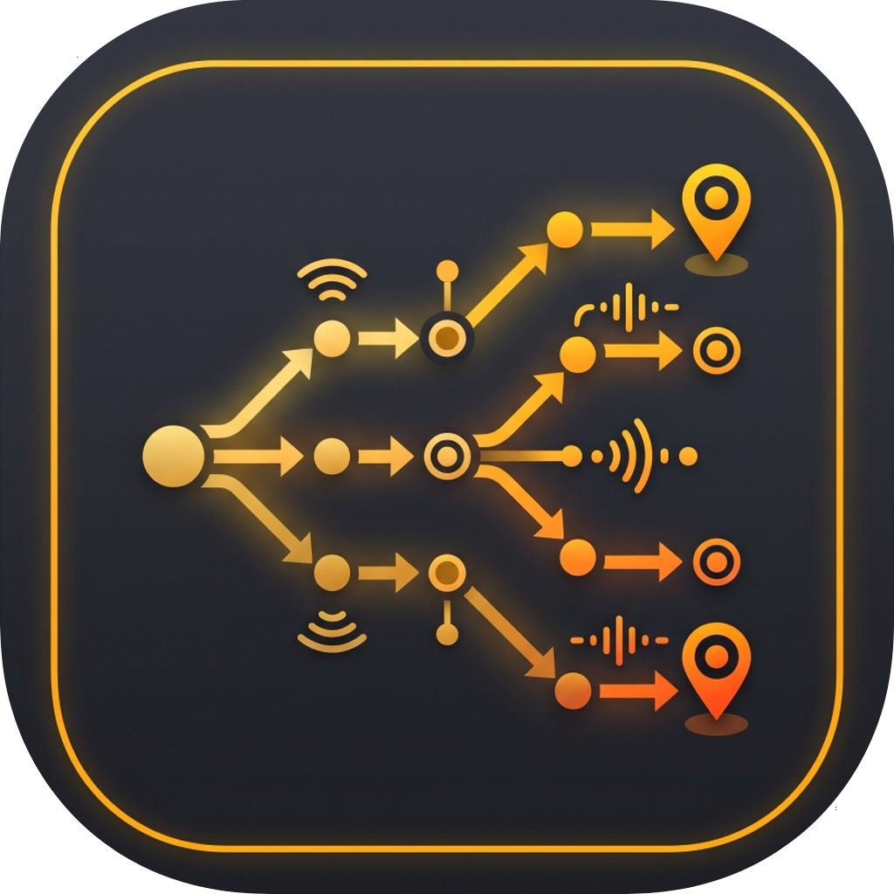

# Net Route Scout (Visual Topology & Multi-Hop Traceroute Mapper)

<p align="center">
  
</p>

A high-performance, dark-first desktop network diagnostic and visual topology tool built with **Flutter Desktop**, designed to discover, trace, and interactively map multi-hop network paths across local and routed infrastructure.

Part of the **Network Suite** family of standalone network utilities.

---

## 🎯 Executive Summary & Purpose

Diagnosing multi-hop enterprise networks, campus subnets, or lab environments often requires running multiple command-line `traceroute` or `tracert` commands and mentally assembling how packets traverse routers, firewalls, and switches. 

**Net Route Scout** automates this workflow:
1. Accepts individual IP addresses, CIDR blocks (e.g. `192.168.1.0/24`), or IP ranges (e.g. `10.0.0.1-50`).
2. Performs an initial rapid pre-flight ICMP sweep to eliminate dead addresses and prime the local operating system's ARP cache.
3. Spawns an asynchronous worker pool running native operating system trace commands (`traceroute` / `tracepath` on Linux, `tracert` on Windows, `traceroute` on macOS).
4. Merges discovered intermediate hops into a consolidated directed acyclic graph (DAG) where shared infrastructure (default gateways, core distribution switches, firewalls) is merged into single nodes and diverging branches visually expand outward.
5. Links directly into the cross-process **Shared Device Database (`shared_devices.db`)**, displaying user-assigned friendly names (e.g. *"Main Gateway Router"*, *"Accounting SQL Server"*, *"CEO MacBook"*) and custom category icons directly on the network canvas.

---

## 🚀 Key Features

- **Visual Directed Acyclic Graph (DAG) Topology**:
  - **Left-to-Right Layered Layout**: Positions your host machine on the far left, intermediate routing hops in the center, and terminal devices expanding outward to the right.
  - **Semantic Color Coding**:
    - 💻 **Host Machine**: Electric Indigo (`#6366F1`)
    - 🔀 **Intermediate Routers / Switches**: Cyan Wave (`#38BDF8`) with routed target counters (e.g. *➔ 4 targets*)
    - 🎯 **Target Endpoints**: Emerald Green (`#10B981`) with final RTT latency
    - ❓ **Filtered / Unresponsive Hops (`* * *`)**: Dim Slate Gray (`#64748B`) with dashed borders to preserve path continuity
  - **Smooth Zoom & Pan**: Wrapped in `InteractiveViewer` (`0.1x` to `3.5x` scale) with mouse-wheel zoom, drag-to-pan, and viewport controls.

- **Shared Device Database Integration (`shared_devices.db`)**:
  - Automatically queries the suite's shared hardware identity database by MAC address.
  - Displays user-assigned device friendly names and custom category badges instead of cryptic IP addresses.
  - Includes an inline **Device Editor**: inspect any node, update friendly names, categories, and notes, and persist immediately to SQLite in WAL mode with real-time reactive UI updates.

- **Two-Phase Discovery Pipeline**:
  - **Phase 1 (Pre-Flight ICMP Sweep)**: Sweeps candidate ranges to weed out unassigned IPs and primes the kernel ARP table.
  - **Phase 2 (Traceroute Worker Pool)**: Spawns parallel trace jobs (configurable from 2 to 16 workers, default 4) to trace only active devices.

- **Background Kernel ARP Cache Harvester**:
  - Reads the local OS ARP table (`ip neigh` on Linux, `arp -a` on Windows/macOS) in the background to correlate L3 IP addresses with L2 MAC addresses and IEEE OUI hardware vendors.

- **Interactive Path Traversal Highlighting**:
  - Clicking any node activates **Path Highlight Mode**: illuminates the exact path back to the host and all routed downstream targets in glowing magenta (`#EC4899`), while dimming unrelated network nodes to 15% opacity.

- **Step-by-Step Traversal Breadcrumb & Route Table**:
  - Inspect exact path hops:
    $$\text{Local PC} \longrightarrow \text{Gateway (192.168.1.1)} \longrightarrow \text{Core Switch (10.0.1.1)} \longrightarrow \text{Target (10.0.1.45)}$$
  - Multi-view workspace: switch effortlessly between the **Interactive Graph Canvas**, a high-density **Route Table View**, or a synchronized **Split View**.

- **Clean Process Lifecycle**:
  - Implements `WidgetsBindingObserver.didRequestAppExit` to ensure zero orphaned background ping or traceroute processes upon closing the application.

- **One-Click Demo Network**:
  - Includes a realistic enterprise multi-hop demo topology to immediately test and explore all features offline.

---

## 🛠️ Architecture

```
lib/
├── core/
│   ├── app_theme.dart               # Material 3 Dark theme tokens (#141414 / #1E1E1E / #007ACC)
│   └── constants.dart               # App configuration & versioning
├── data/
│   ├── repositories/
│   │   └── topology_repository.dart # DAG state, node deduplication & breadcrumb solver
│   └── services/
│       ├── arp_service.dart         # System ARP table reader & OUI vendor lookup
│       ├── demo_data_generator.dart # Enterprise multi-hop sample dataset
│       ├── export_service.dart      # JSON topology export & clipboard handler
│       ├── icmp_service.dart        # Rapid pre-flight ICMP echo sweep
│       ├── shared_device_service.dart # SQLite shared_devices.db client & category resolver
│       └── traceroute_service.dart  # Native OS traceroute spawner & worker pool
├── domain/
│   └── models/
│       ├── network_edge.dart        # Graph edge with target reference tracking
│       ├── network_node.dart        # Deduplicated node with Shared Device metadata
│       ├── scan_progress.dart       # Two-phase progress model
│       ├── trace_hop.dart           # Parsed single-hop telemetry
│       └── trace_result.dart        # Multi-hop trace result
└── ui/
    ├── view_models/
    │   └── topology_view_model.dart # ChangeNotifier state coordinator
    └── views/
        ├── main_screen.dart         # 5-tier desktop screen layout & lifecycle observer
        └── widgets/
            ├── alert_banner.dart    # Live progress bar & status notifications
            ├── detail_inspector_panel.dart # Click-to-inspect device & path drawer
            ├── edit_device_dialog.dart     # Modal for updating shared device identities
            ├── filter_toolbar.dart         # Target input, presets, workers & search
            ├── node_card_widget.dart       # Semantic node card with highlight glows
            ├── route_table_view.dart       # Virtualized route table with sortable columns
            ├── top_control_bar.dart        # Title, host info, DB sync & export controls
            └── topology_canvas.dart        # Interactive DAG canvas with bezier curves
```

---

## 📦 Building and Running

### Prerequisites
- Flutter SDK (3.13+)
- C++ build tools (Visual Studio 2022 on Windows, Clang/CMake/Ninja on Linux, Xcode on macOS)

### Run in Debug Mode
```bash
flutter run
```

### Run Tests
```bash
flutter test
```

### Build Platform Binaries
```bash
# Windows (x64)
flutter build windows --release

# Linux (x64)
flutter build linux --release

# macOS (Universal)
flutter build macos --release
```

---

## ⚠️ Security & Code Signing Notes

> **Note on Windows / macOS Security Prompts:**
>
> These tools are free, open-source community utilities and are not signed with expensive commercial developer certificates:
>
> - **Windows**: If Microsoft Defender SmartScreen appears with *"Windows protected your PC"*, click **"More info"** → **"Run anyway"**.
> - **macOS**: Right-click the `net_route_scout.app` bundle in Finder, select **Open**, and confirm the dialog (or run `xattr -cr /path/to/net_route_scout.app` in Terminal).

---

## 📄 License

MIT License. Copyright (c) 2026 Tom McGuire.
